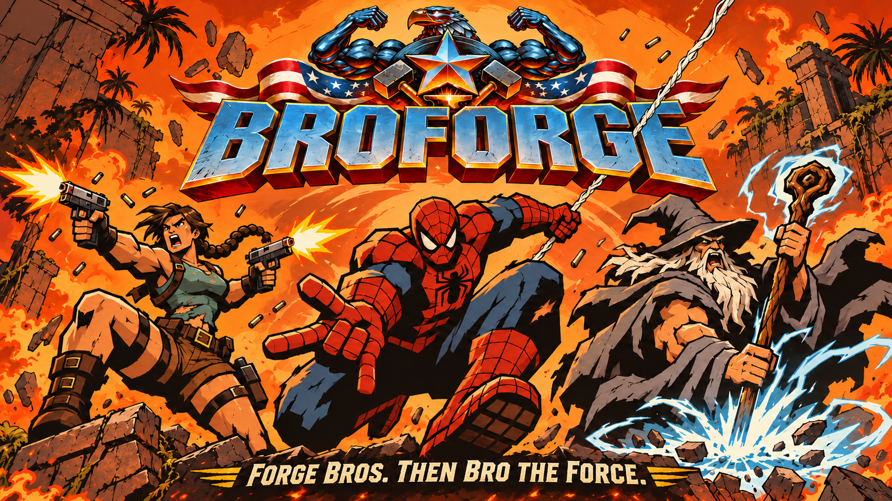
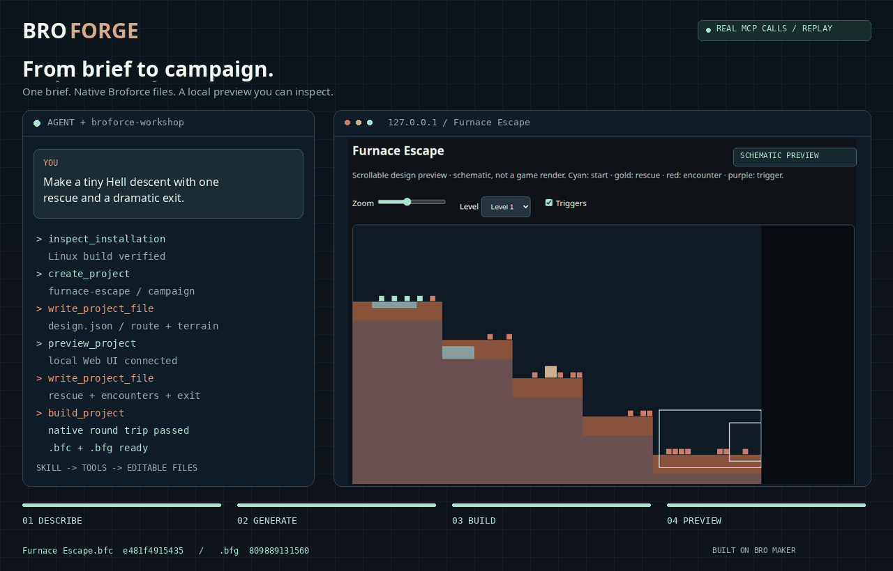
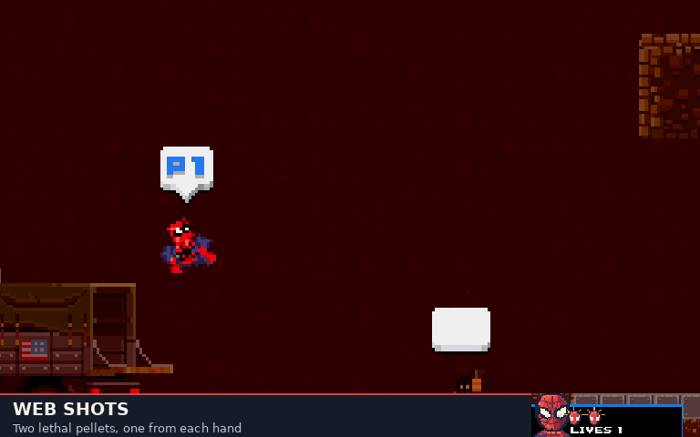

# BroForge



<p align="center"><strong>Linux · MCP · BroMaker · Local-first</strong></p>

A local Linux authoring kit for **custom BroMaker characters and campaigns using Broforce's existing environments**. An agent can create editable projects, invoke the game's real campaign serializers, compile character DLLs, preview content on a local website, install it, and control a separate modded game for playtests.

The MCP server, CLI, four agent skills, project library, and preview site are implemented. This is a local checkout, not a published npm package. GitHub synchronization and full-level game-rendered panoramas are not implemented. The level viewer currently shows an explicitly labeled schematic.

## From a brief to a custom campaign

Describe your level, let your agent call the MCP tools, and inspect the result in the local Web UI.



*20-second workflow replay using real MCP results and captures of the local Web UI. Timing is edited. The map is a schematic preview; this demo builds files without installing or playtesting them. [Media details and regeneration](docs/media/README.md).*

## Spider Bro: a playable bundled character



**Spider Bro 0.2.5** is included as an editable character, with the approved sprite animations, chest emblem, HUD portrait and special icon. The GIF is real gameplay captured through MCP: lethal twin web shots, Spider Sense activated through the normal special input, and a sustained web swing followed by release. It is cropped and captioned; no gameplay poses or mechanics are fabricated.

| Input | Behavior |
|---|---|
| Tap fire | Two damaging web pellets, one from each hand |
| Hold fire | Attach a web and swing using inherited Indiana rope physics |
| Release fire | Let go with an airborne launch boost |
| Special | Five seconds of Spider Sense protection and dodge reactions; three charges |
| Melee | Punch enemies, props and blocks ahead; crouch to punch the floor |

Create your own working copy through MCP:

```javascript
create_project({id: "spider-bro", kind: "bro", name: "Spider Bro", template: "spider-bro"})
play_project({id: "spider-bro"})
```

`play_project` builds and installs the character and an editable playtest campaign, then checks the actual loaded class and assembly identity. The [character sources, assets and credits](library/bros/spider-bro/README.md) and [recording arena](library/campaigns/spider-bro-showcase/README.md) are bundled. The introduction cutscene is disabled for the Indiana adapter; native rope behavior and sounds remain inherited. The arena is for feature tests, not a campaign completion demo.

To recreate the footage after workspace setup, close any running Broforce session and run `node scripts/capture_spider_demo.js`. This explicit live test launches the game and controls player one. Raw frames and the MCP transcript stay under `.broforge/runtime/`; the small GIF and sanitized evidence are under `docs/media/`. See [media details](docs/media/README.md).

## Quick setup

Requires Linux x86_64, a supported installed Broforce build, Node 22+, Python 3.12+, Steam, and a graphical session for play. Game assemblies stay in the purchased installation. Toolchain downloads, mod dependencies, runtime profiles, backups, and logs stay in the selected workspace. Setup does not install demo campaigns or change Steam.

This is a local checkout, not a published npm package. Install this server's Node dependencies once with `npm ci` in the checkout. From the directory where you want to author content:

```bash
node /absolute/path/to/BroForce/src/cli.js --workspace "$PWD" setup
node /absolute/path/to/BroForce/src/cli.js --workspace "$PWD" doctor
node /absolute/path/to/BroForce/src/cli.js --workspace "$PWD" config
```

The workspace contains `broforge.json`, editable `projects/`, a `play-broforce` launcher, and `.broforge/` managed state. The state directory contains `.toolchain/`, `dependencies/`, `runtime/profile/`, ownership records and backups. No game copy or global .NET installation is required. The server package remains the read-only source of templates, bridge code, and bundled skills.

Broforce must be closed while preparing the profile. `setup --skip-profile` prepares authoring tools only. `init --no-prepare` creates the workspace without downloads. `setup --repair` explicitly refreshes an existing setup. `--game-path PATH` binds an installation; `BROFORCE_GAME_PATH` overrides discovery. Unknown game builds are rejected; the tested assembly SHA-256 is `d518444c45ba73f834bfbd163973f3c0fdbb935522144d9b95e6db74029a6b86`.

Through MCP, call `initialize_workspace` and poll `workspace_status`: setup runs as a local job and survives an individual tool request timing out. Progress/errors are in `.broforge/runtime/setup.log`. Normal serving and inspection do not download dependencies implicitly.

### Play and optional Steam integration

`play_project(id)` resolves local character dependencies, builds current content, installs it, launches the managed profile and verifies the loaded map and initial bro. Selecting a bro creates an editable playtest campaign. A required restart is reported; `restart=true` authorizes restarting this workspace's running game. Runtime loading is separate from testing mechanics or finishing a level.

Run `./play-broforce` for everyday modded play. It uses the purchased installation and this workspace's profile. There is no second full game installation. Normal Steam launch remains unchanged unless you explicitly enable integration.

To make Steam's existing Play button select this profile, use `configure_launch(mode="steam", action="plan")`, review its exact settings change, then `action="apply"` with its `planId`. Steam must be closed. Existing launch options are composed with the wrapper, and only Broforce's launch-options setting is edited. `action="status"` gives the current removal plan; `action="remove"` restores the recorded original setting without replacing unrelated Steam preferences.

Native campaign files must be installed into the game's `Levels` folder. Physical filenames include the workspace ID to prevent collisions between workspaces; game metadata keeps the campaign name. These external writes, optional skill exports and launch settings are tracked for removal. Authored projects and mod packages stay local. Installing a bro does not imply forcing it as every spawn: campaign `initialBro` controls repeatable first spawns; normal availability follows BroMaker settings.

### Remove managed changes

Use the bundled **uninstall** skill or `uninstall_workspace` for a dry run. Apply its returned `planId` to restore replaced files/settings and remove unchanged files created by this workspace, including setup runtime, launchers and exported skills. Authored projects, build history, backups and audit records are retained. Modified files and missing/corrupt backups block removal instead of being overwritten. `includeRuntime=false` keeps the setup runtime. `uninstall_project` removes just one character or campaign.

A CLI equivalent is `uninstall`, followed by `uninstall --apply --plan-id ID`. Untracked legacy installs are reported rather than silently adopted. Another workspace's installations and the purchased game are not removed.

## Connect another agent

`node src/cli.js config` prints ready-to-copy JSON with the actual absolute Node and server paths. Add its `broforce-workshop` entry to your MCP client's configuration. The entry has this shape:

```json
{
  "mcpServers": {
    "broforce-workshop": {
      "command": "/absolute/path/to/node",
      "args": ["/absolute/path/to/BroForce/src/cli.js", "serve"]
    }
  }
}
```

The server uses **stdio**. Do not start the preview command as the MCP server. The generated configuration binds BROFORCE_WORKSPACE explicitly, independently of the client working directory. Use the generated config rather than these example paths. Set BROFORCE_WORKSPACE in the client env to the intended workspace; an optional BROFORCE_PROJECTS_DIR must remain inside it.

The server exposes the skills as MCP resources and starter prompts. For automatic skill discovery, explicitly export the four bundled skills into your agent's skill directory:

```bash
node src/cli.js --workspace /path/to/workspace install-skills /path/to/your/agents/skills
```

Exports are journaled and differing existing files are refused. MCP connection alone does not configure your client's normal skill discovery. No global agent configuration is changed automatically.

**Give your agent this prompt:**

> Set up the existing Broforce Workshop MCP from this checkout. Read README.md first. Run npm ci, inspect the installation, and run npm run setup with Broforce closed; use BROFORCE_GAME_PATH if needed. Do not create another server implementation. Generate the MCP entry with node src/cli.js config and add it using this client's supported configuration mechanism. Install the four skills into this agent's skill directory if it supports skills. Reconnect if necessary, then verify that inspect_installation works and read broforce://guide. Tell me when the tools are connected and which game build is supported.

**Then try this prompt:**

> Use the Broforce Workshop MCP and its campaign skill to create a new very short Hell campaign called Furnace Escape. Make a distinct descending route with one rescue and a working exit. Use native vanilla bro selection for this first campaign. Build it and show me the local preview, then install and playtest it. Inspect the actual runtime character classes and completion result; report anything untested.

For a character:

> Use the Broforce Workshop bro and artwork skills to make a new rifle-based bro called Ember Ranger. Give it original artwork and an introduction portrait, using the included asset guide and BroMaker documentation to understand the asset roles. Use your image tools for art, and the MCP for project creation, imports, builds, preview, installation, and game testing. Keep the rifle template where appropriate and tell me which behaviors remain inherited. If image generation is unavailable, tell me before presenting inherited art as original.

## Tools and references

| Tool | What it does |
|---|---|
| `initialize_workspace`, `workspace_status` | Prepare and inspect workspace-local tooling/profile |
| `play_project` | Build dependencies, install, launch and verify map/character loading |
| `configure_launch`, `uninstall_workspace` | Optional reversible Steam launch integration and tracked cleanup |
| `inspect_installation` | Fingerprint, compatibility, prerequisites and bridge state |
| `create_project`, `list_projects`, `read_project` | Persistent editable campaign or bro projects |
| `write_project_file`, `configure_project`, `import_bro_asset` | Edit sources/settings and import local PNG/WAV assets |
| `inspect_native_catalog` | Discover real settings and enum values from the installed assembly |
| `build_project` | Native `.bfc`/`.bfg` serialization or Unity-compatible bro DLL compilation |
| `preview_project` | Start a read-only local website and return the project's URL |
| `install_project`, `uninstall_project` | Install current builds, remove unchanged installed files, restore recorded backups |
| `game_control` | Launch, inspect, load maps, select a bro, bounded movement/fire/special/melee input, game-view recording, quit |

Resources: `broforce://guide`, `broforce://skill-create-campaign`, `broforce://skill-create-bro`, `broforce://skill-bro-art`, `broforce://campaign-design`, and `broforce://bro-assets`. Prompts: `create-campaign` and `create-bro`.

The campaign tool constructs **real Campaign, MapData, terrain, doodad and trigger objects**, then invokes the installed game's native serializers without running Unity. It accepts multiple levels and the currently supported LevelEvent action structure; it is not a full replacement for every editor feature. [Native tool format and usage](tools/NativeCampaignTool/README.md).

The bro scaffold is a new preset inheriting BroMaker's Rambro adapter. It compiles against the game's older Mono assemblies, separately from the .NET 8 authoring host. It initially uses vanilla behavior/art. Original art and mechanics require actual editing and testing. Image generation comes from your agent's image tools; this server does not contain an image model or require an image API key.

For a client that strips graphical environment variables, launching recovers display settings from the existing systemd user session. On a non-systemd desktop, provide DISPLAY/XAUTHORITY or WAYLAND_DISPLAY/XDG_RUNTIME_DIR in the MCP client env.

A custom first bro is an explicit campaign dependency. The installed campaign policy configures initial spawning and later vanilla selection. Installing a new/changed character DLL requires restarting the Workshop game. It is not embedded inside `.bfg`.

## Preview and play

Ask the agent to call `preview_project`, or start a persistent preview site yourself:

```bash
npm run preview
```

Open the printed loopback URL. The site provides a project library, scrollable/zoomable campaign maps with optional trigger overlays, character images, configured animation loops, build findings, and the assets you import into your projects. It is a viewer; ask the agent for edits, installation and playtests. Schematic previews and animation loops are separate from actual game rendering and gameplay verification.

Start the modded game manually with:

```bash
./play-broforce
```

Or use MCP `game_control(action="launch")`. Installed campaigns appear in **Custom Campaigns**. The original standalone game client remains available as `python3 scripts/workshop.py --help`.

Projects store sources, `build/report.json`, generated artifacts, and `records/` installation/observation receipts. Builds have source/artifact hashes and game/dependency identity; installation refuses stale sources, altered output, and conflicting files unless overwrite is explicitly requested. Replaced files are backed up under `runtime/backups/`. Playtest observations do not automatically imply a successful gameplay test.

## Verification

```bash
npm test
python3 -m unittest discover -s tests
```

The MCP tests spawn a real stdio client from outside the checkout, discover tools/resources/prompts, build real native campaigns and bro DLLs when setup is available, serve previews, and verify error paths. They do not modify game levels or launch the game. Native checks need completed setup; diagnostics state when those integration portions cannot run.

An explicit full game smoke test creates and installs **Workshop Rifle Test** and **Workshop MCP Smoke**, launches the Workshop profile, checks the initial class and vanilla rescue, and drives through normal campaign completion:

```bash
node scripts/smoke_mcp.js
```

Close Broforce first. This test takes over game input. Its report is `runtime/mcp-live-smoke.json`; test projects remain in the local library for inspection.

## Scope and provenance

Linux and one local player are the verified scope. There is no Windows support, online multiplayer promise, remote GitHub sync, hosted image generation, or stitched Unity level capture in this version. Read [the agent guide](docs/mcp-guide.md) and [native interface evidence](docs/native-interface.md) for detailed boundaries.

Pinned upstream dependencies are UMM, RocketLib, and BroMaker. No third-party character package is bundled or fetched by setup. Game assemblies are resolved from each user's installation and excluded from distributable code. The [High Ground demo](library/levels/high-ground/README.md) uses native vanilla hero selection; custom first-spawn selection is configured explicitly per authored campaign.

## Credits

Custom character support is built on **[BroMaker](https://github.com/Gorzontrok/Bro-Maker)**, created and maintained by **[Gorzontrok](https://github.com/Gorzontrok)**. BroForge uses BroMaker's character framework, configuration and integration APIs; it does not replace that work. BroMaker credits **[alexneargarder](https://github.com/alexneargarder)** for the original custom-bro groundwork.

The mod profile also uses [RocketLib by Gorzontrok](https://github.com/Gorzontrok/RocketLib) and [alexneargarder's Unity Mod Manager fork](https://github.com/alexneargarder/unity-mod-manager). Dependency versions and hashes are pinned in `dependencies.lock.json` and fetched during setup. Third-party code retains its upstream license.

Broforce is developed by [Free Lives](https://freelives.net/). This is an independent authoring tool and requires your own installed copy of the game.

The repository's existing [AGPLv3 license](LICENSE) is retained. Third-party dependencies and assets retain their respective licenses and credits. Proprietary game assemblies, local mod binaries, caches, and reverse-engineering dumps are not included in this repository. Historical verification records replace machine-specific paths with `${WORKSHOP_ROOT}` and `${BROFORCE_GAME_PATH}`; artifact hashes remain unchanged.
